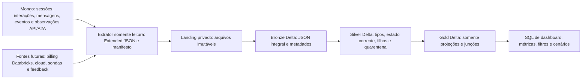

# Arquitetura de dados e BI da IA Argos

**Implementação posterior disponível:** `databricks/README.md`, notebooks e módulos em `databricks/`. Para copiar/importar pipelines, use essa implementação e seu guia, que detalham os modos reais de conexão, snapshots e deduplicação por extração. Os SQLs deste plano e `exemplos-camadas.sql` eram representativos; os notebooks completos passam a ser a referência operacional. A análise de fontes e as ressalvas de métricas abaixo continuam válidas.

Data da análise: **19/10/2026**. Escopo: diagnóstico e projeto; nenhum serviço, banco, job ou repositório de aplicação foi alterado. Os SQLs anexos são propostas executáveis depois da implantação das tabelas descritas, não objetos já existentes. Não houve acesso ao Mongo de execução, faturas ou workspace Databricks; não há resultados medidos de produção neste documento.

## 1. Base examinada e evidências

Referência principal: `argos-ai-service`, branch local `feat/api`, commit `d6c0349a62220ec24ffbeafb7bcbe01cb7d245bb`, de 19/10/2026. A inspeção foi de código e documentos locais; a referência Git e a igualdade de hashes de `models.py`, `session_service.py`, `dicionario-mongodb-bi.md` e `execution_observer.py` com a branch foram confirmadas. A leitura do status/diff integral da árvore foi limitada pelo sandbox. Não se certifica sincronismo com uma branch remota. Os links abaixo apontam ao commit para revisão das evidências.

| Ref. | Arquivos examinados | Evidência e consequência |
|---|---|---|
| E1 | [agent.md](https://github.com/Argos-app/argos-ai-service/blob/d6c0349a62220ec24ffbeafb7bcbe01cb7d245bb/agent.md), [planejamento](https://github.com/Argos-app/argos-ai-service/blob/d6c0349a62220ec24ffbeafb7bcbe01cb7d245bb/docs/planejamento-sistema-agentes-argos.md) | Orientação para distinguir planejamento de implementação. Cinco aplicações; não transformar recomendações de Prometheus/OTel/Grafana ou treinamento em entregas comprovadas. |
| E2 | [models.py](https://github.com/Argos-app/argos-ai-service/blob/d6c0349a62220ec24ffbeafb7bcbe01cb7d245bb/packages/observability/models.py) | Contrato normativo `Observation` v1/v2, enums, IDs, datas UTC, duração monotônica, tokens, cobrança e recursos opcionais. |
| E3 | [mongo_repository.py](https://github.com/Argos-app/argos-ai-service/blob/d6c0349a62220ec24ffbeafb7bcbe01cb7d245bb/apps/main_api/app/infrastructure/observability/mongo_repository.py), [writer.py](https://github.com/Argos-app/argos-ai-service/blob/d6c0349a62220ec24ffbeafb7bcbe01cb7d245bb/apps/main_api/app/infrastructure/observability/writer.py) | Mesmo `_id` passa de started a terminal; writer assíncrono com fila em memória. Não há ledger durável completo. Decimal vira Decimal128; `updated_at` é atualizado na serialização. |
| E4 | [extração Mongo](https://github.com/Argos-app/argos-ai-service/blob/d6c0349a62220ec24ffbeafb7bcbe01cb7d245bb/docs/observabilidade-extracao-mongo.md), [operação](https://github.com/Argos-app/argos-ai-service/blob/d6c0349a62220ec24ffbeafb7bcbe01cb7d245bb/docs/operacao-observabilidade.md), [dicionário BI](https://github.com/Argos-app/argos-ai-service/blob/d6c0349a62220ec24ffbeafb7bcbe01cb7d245bb/docs/dicionario-mongodb-bi.md) | Paginação por `(updated_at,_id)`, watermark superior e lookback. A2A opcional; MCPs não têm collections próprias de observabilidade. Redis não é janela móvel exata de 24h. |
| E5 | [sessions.py](https://github.com/Argos-app/argos-ai-service/blob/d6c0349a62220ec24ffbeafb7bcbe01cb7d245bb/apps/main_api/app/domain/sessions.py), [persistência Mongo](https://github.com/Argos-app/argos-ai-service/blob/d6c0349a62220ec24ffbeafb7bcbe01cb7d245bb/apps/main_api/app/infrastructure/persistence/mongo.py), [session_service.py](https://github.com/Argos-app/argos-ai-service/blob/d6c0349a62220ec24ffbeafb7bcbe01cb7d245bb/apps/main_api/app/application/session_service.py) | Sessão, interação, mensagens e eventos funcionais. `degraded` está no código, embora a lista de status de interações do dicionário o omita. Cada continuação é outra interação. `payload_json` da mensagem de entrada de resposta guarda a interação fonte e question_id. |
| E6 | [contrato InteractionOutcome](https://github.com/Argos-app/argos-ai-service/blob/d6c0349a62220ec24ffbeafb7bcbe01cb7d245bb/apps/main_api/app/application/contracts/interactions.py), [execution_observer.py](https://github.com/Argos-app/argos-ai-service/blob/d6c0349a62220ec24ffbeafb7bcbe01cb7d245bb/apps/main_api/app/infrastructure/agents/execution_observer.py) | `result_json` contém status, response.kind e degradation_reasons[]. Eventos têm IDs por invocação/estado. Texto sanitizado de saída pode ser truncado a 8.000 caracteres; não é fonte infalível de avaliação. |
| E7 | [model_callbacks.py](https://github.com/Argos-app/argos-ai-service/blob/d6c0349a62220ec24ffbeafb7bcbe01cb7d245bb/apps/main_api/app/infrastructure/observability/model_callbacks.py), [billing.py](https://github.com/Argos-app/argos-ai-service/blob/d6c0349a62220ec24ffbeafb7bcbe01cb7d245bb/packages/observability/billing.py), [settings.py](https://github.com/Argos-app/argos-ai-service/blob/d6c0349a62220ec24ffbeafb7bcbe01cb7d245bb/apps/main_api/app/settings.py) | Callback `model.invoke`, nível sdk_invocation. Custo provider tem precedência; fallback global USD por milhão não é tarifa oficial por modelo. Modelos dependem de configuração; retries SDK podem ser invisíveis. Limite padrão de 12 chamadas de modelo é teto, não média. |
| E8 | [main.py](https://github.com/Argos-app/argos-ai-service/blob/d6c0349a62220ec24ffbeafb7bcbe01cb7d245bb/apps/main_api/app/main.py), [workflow.py](https://github.com/Argos-app/argos-ai-service/blob/d6c0349a62220ec24ffbeafb7bcbe01cb7d245bb/apps/main_api/app/graph/workflow.py), [langchain_factory.py](https://github.com/Argos-app/argos-ai-service/blob/d6c0349a62220ec24ffbeafb7bcbe01cb7d245bb/apps/main_api/app/infrastructure/agents/langchain_factory.py) | HTTP `http.request` exclui health. `interaction.process` envolve entrada/replay; `graph.execute`/`graph.resume` têm IDs funcionais. Especialistas seguem tarefas/dependências; não há base para impor soma de durações como wall time. |
| E9 | [cliente A2A](https://github.com/Argos-app/argos-ai-service/blob/d6c0349a62220ec24ffbeafb7bcbe01cb7d245bb/apps/main_api/app/infrastructure/a2a/client.py), [answers.py A2A](https://github.com/Argos-app/argos-ai-service/blob/d6c0349a62220ec24ffbeafb7bcbe01cb7d245bb/apps/a2a_agent/src/argos_a2a_agent/adapters/providers/answers.py), [embeddings.py A2A](https://github.com/Argos-app/argos-ai-service/blob/d6c0349a62220ec24ffbeafb7bcbe01cb7d245bb/apps/a2a_agent/src/argos_a2a_agent/adapters/providers/embeddings.py), [http.py A2A](https://github.com/Argos-app/argos-ai-service/blob/d6c0349a62220ec24ffbeafb7bcbe01cb7d245bb/apps/a2a_agent/src/argos_a2a_agent/adapters/providers/http.py) | Spans cliente A2A, servidor e modelos são níveis diferentes da mesma operação. Modelos `model.a2a.answer.generate` e `embedding.a2a.embed` têm nível transport_attempt. Não somar cobrança de wrappers com cobrança da chamada. |
| E10 | [MCP predição](https://github.com/Argos-app/argos-ai-service/blob/d6c0349a62220ec24ffbeafb7bcbe01cb7d245bb/apps/mcp_prediction/MCP.md), [MCP e-mail](https://github.com/Argos-app/argos-ai-service/blob/d6c0349a62220ec24ffbeafb7bcbe01cb7d245bb/apps/mcp_email/MCP.md), [homologação](https://github.com/Argos-app/argos-ai-service/blob/d6c0349a62220ec24ffbeafb7bcbe01cb7d245bb/docs/resultado-homologacao-local.md) | Predição atual é extrapolação determinística, sem modelo treinado. Aceite de e-mail não é entrega. Homologação documentada é local e usa provedores simulados. |
| E11 | [plano histórico de observabilidade](https://github.com/Argos-app/argos-ai-service/blob/d6c0349a62220ec24ffbeafb7bcbe01cb7d245bb/docs/plano-observabilidade-dados-brutos.md) | A errata de 18/10 substitui conclusões antigas sobre falta de custos. Decisão vigente de 13/10 não prevê criar ledger durável separado. |

Projetos relacionados examinados: `argos-bi-repository` em `af8791e88333527148a39e68ce065cc8e349654d`: [README Databricks](https://github.com/Argos-app/argos-bi-repository/blob/af8791e88333527148a39e68ce065cc8e349654d/databricks/README.md), [bronze.py](https://github.com/Argos-app/argos-bi-repository/blob/af8791e88333527148a39e68ce065cc8e349654d/databricks/argos/bronze.py), [gold.py](https://github.com/Argos-app/argos-bi-repository/blob/af8791e88333527148a39e68ce065cc8e349654d/databricks/argos/gold.py). Já usam Delta comum e Gold de junções. A Silver atual aplica UPPER em strings: **não reutilizar essa regra para IA**, pois altera IDs, JSON, nomes de modelos e códigos. A ingestão JDBC atual não ingere os JSONs Mongo da IA.

`argos-data-engineering`, commit `2f24af7abd25ab4afda7cb1561f02973db0b19d5`: [02_tabelas.sql](https://github.com/Argos-app/argos-data-engineering/blob/2f24af7abd25ab4afda7cb1561f02973db0b19d5/modulos/02_tabelas.sql), [10_dataload_completo.md](https://github.com/Argos-app/argos-data-engineering/blob/2f24af7abd25ab4afda7cb1561f02973db0b19d5/modulos/10_dataload_completo.md). `app_user.id`, `property.id` e associação `user_property` existem; dados da carga são fictícios. Vínculo UUID com `user_id`/`farm_ids` da IA é pretendido e precisa ser homologado entre ambientes. Não unir telemetria a cada fazenda autorizada como se a operação tivesse ocorrido em todas elas.

## 2. Diagnóstico: disponível, derivável e novo

**Disponível** significa implementado no contrato/produtor, não presença garantida em toda linha ou produção.

| Tema | Disponível | Derivável no lakehouse | Nova fonte/instrumentação necessária |
|---|---|---|---|
| Uso | Interações deduplicadas, user_id, sessão, kind, datas, estados, mensagens | WAU, sessões, perguntas iniciais vs esclarecimentos, throughput observado | Tráfego rejeitado antes da persistência exige HTTP/gateway; atividade fora da IA não é WAU da IA |
| Desempenho | start/end/duration dos spans; árvore parent; graph execute/resume; eventos por invocation | Percentis por etapa; duração HTTP observada; intervalos ocupados sem duplicar paralelismo | Tempo percebido no dispositivo, DNS/rede cliente, TTFT/streaming e fronteira exata de handoff não têm contrato demonstrado |
| Confiabilidade | status/error, timeout_phase, attempt_reason/visibility, result, replayed_result opcionais | Falhas por camada, retries visíveis, órfãos e started envelhecidos | Sondas externas contínuas, perdas da fila com contadores duráveis/exportados, todos os retries internos, endpoint do provider na API principal |
| Tokens/custo | usage opcional, billing provider/configured_rate; modelos solicitados/retornados | Somas conhecidas e cobertura; custo parcial por interação/ciclo | Faturas/contratos, tarifas por versão/modelo/tier/cache, câmbio, contas cloud, atribuição de infraestrutura |
| Resolução | result.response.kind answer/question, status completed/degraded; link fonte em mensagens answer | Ciclos de esclarecimento e proxy de conclusão técnica | Confirmação humana/negócio de resolução, abandono explícito, task outcome externo. Não existe `resolved=true` comprovado |
| Qualidade | JudgeResult no código; saída sanitizada de evento do agente judge; degradation_reasons[] no resultado | Taxa de degradação; decisão do juiz apenas se JSON válido, íntegro e compatível | Nota humana, satisfação, ground truth, precisão factual, resultado clínico, identificação explícita de resposta avaliada |
| Ferramentas/e-mail | Eventos target=tool; dispatch state, error_code, IDs | Sucesso técnico, ferramentas mais chamadas, recorrência de códigos | Não inferir entrega/leitura de e-mail de accepted; webhooks do provider seriam nova fonte |

Não assumir presença de farm efetivamente consultada em `Observation`: `farm_ids` é escopo da sessão criada, não localização factual nem autorização BI atual. Não assumir modelo fixo a partir de `.env.example` ou de nomes em `model_options.py`. Não gerar métricas de treino/qualidade de predição como se houvesse modelo estatístico treinado.

## 3. Fluxo e organização

Catálogo proposto `ai_bi`, schemas `bronze`, `silver`, `gold`, `ops`. Os exemplos usam estes nomes fixos para serem copiáveis. `ops` mantém manifestos/checkpoints/resultados de qualidade operacionais; não é camada de indicadores de negócio. Todo cálculo de dashboard ocorre nos SELECTs de `queries-dashboard.sql`; CTEs são efêmeras. Não criar views, tabelas agregadas ou materializações para esses SELECTs. Persistir Gold de junções é permitido e diferente de persistir consultas de indicadores.

### Bronze: JSONs integrais

Uma tabela por família/collection; nomes configuráveis da origem são resolvidos no manifesto, nunca presumidos pelo extrator. Todas têm: `source_system`, `source_database`, `source_collection`, `source_environment`, `document_id`, `source_updated_at`, `source_version`, `raw_json STRING`, `payload_sha256`, `extracted_at`, `ingested_at`, `batch_id`, `source_path`, `record_ordinal`, `extractor_version`, `snapshot_id`, `is_deleted` (somente metadado de CDC/tombstone confirmado). Esses campos são **metadados propostos**, não campos Mongo existentes. `raw_json` guarda Extended JSON canônico UTF-8 completo com arrays e campos desconhecidos; não projetar só o contrato do MCP. BSON Date, Decimal128 e UUID/Binary preservam representação. Bytes/arquivo e hash ficam na landing para auditoria. Hash normaliza ordem de chaves, preservando ordem de arrays.

| Tabela Bronze proposta | Origem e granularidade | Incremental/chave de versão |
|---|---|---|
| `b_sessions` | ai_sessions; uma versão extraída de sessão | `_id`, updated_at, hash |
| `b_interactions` | ai_interactions; versão de interação | `_id`, version/updated_at, hash |
| `b_messages` | ai_messages; documento mensagem | `_id`, created_at, hash; append deduplicado |
| `b_execution_events` | ai_execution_events; evento de início OU término, não invocação | `_id`, created_at, hash; append deduplicado |
| `b_observations` | API e A2A; versão de tentativa observada | `(ambiente,db,collection,_id)`, updated_at, hash |
| `b_email_dispatches`, `b_email_reports` | Dispatch e preparação MCP, respectivamente; documento/versão | updated_at para dispatch; snapshot/hash para preparado sem watermark de mudança |
| `b_report_artifacts`, `b_email_preparations`, `b_email_authorizations`, `b_email_operation_references`, `b_pending_recipient_resolutions` | Cada collection homônima do dicionário; documento/versão | Datas de criação/registro não são watermark seguro de todas as mutações; snapshot com hash ou CDC homologado |
| `b_session_summaries`, `b_user_memory` | Revisão corrente extraída; opt-in restrito | `_id`, revision, updated_at, hash; histórico somente após primeira coleta |
| `b_cattle_documents`, `b_medicine_documents` | Documentos externos lidos pelo MCP; opcionais, fora do MVP telemetria | last_updated_at opcional: snapshot se ausente; contrato do produtor obrigatório |

Checkpoints LangGraph não são fonte analítica estável: excluir do escopo de BI. Não extrair credenciais/delegações. Relatórios, memória e documentos de negócio só entram com finalidade definida, acesso restrito e retenção aprovada; a Bronze destes preserva o JSON completo, inclusive conteúdo sensível, sem torná-lo público.

**Carga inicial:** snapshot completo limitado por watermark quando disponível. Observações: seguir E4, páginas 500, par `(updated_at,_id)` ascendente, limite superior obtido no início, lookback inicial de 5 min. Confirmar checkpoint somente após commit Delta de todas as páginas. Uma execução concorrente por origem; lease do extrator evita watermarks concorrentes. Falha reinicia do último checkpoint confirmado. Janela é recomendação, não garantia contra relógio incorreto ou backdating; conciliação completa periódica captura alterações mais antigas.

Bronze preserva versões em append lógico idempotente, usando MERGE insert-only pela identidade da origem + document_id + source_updated_at/source_version + payload_sha256. Repetir página não duplica versão. `started` e terminal diferentes permanecem na Bronze; Silver publica só o estado atual. Não deduplicar por correlation_id, session_id ou conteúdo textual. Mesmo timestamp e versões diferentes: preservar ambos e sinalizar conflito; observação terminal prevalece sobre started, mas dois terminais divergentes são quarentena, sem desempate arbitrário por ingestão.

Mensagens/eventos imutáveis: cursor created_at+id com lookback, mais reconciliação por IDs/hashes. Collections mutáveis sem timestamp confiável: snapshot periódico com manifesto de completude, incluindo snapshot vazio. Remoções/TTL: não inferir delete de falha de extração; usar inventário completo validado ou CDC homologado. Preservar histórico sob política de retenção, sem ressuscitar registros excluídos em Silver. TTL de 31 dias em várias collections funcionais exige coleta antes da expiração; não recupera histórico já apagado.

Esquema Bronze externo é estável; novas propriedades ficam imediatamente no JSON integral. Silver tem parsers versionados v1/v2, campos adicionais retidos em raw; mudanças incompatíveis vão para quarentena. Não usar inferSchema/overwriteSchema silenciosos para tipo monetário. Auto Loader pode detectar arquivos de landing, mas sua evolução de JSON não substitui validação BSON: [documentação oficial](https://docs.databricks.com/aws/en/ingestion/cloud-object-storage/auto-loader/schema).

### Silver: catálogo e tipos

Convenções: IDs STRING canônicas sem UPPER; timestamps TIMESTAMP UTC; contagens BIGINT não negativas; duração DOUBLE; custo DECIMAL(38,20), recursos DECIMAL(30,10); enums STRING validadas; booleanos BOOLEAN. `source_environment` sempre participa da PK lógica. Nas tabelas abaixo usa-se `env` como alias desse ambiente. Arrays não são convertidos em texto. Campos originais de conteúdo ficam em área restrita; tabelas de consumo levam apenas campos necessários. Todas carregam `bronze_version_key`, `source_updated_at`, `transform_version`, `published_batch_id` para rastreio.

| Silver proposta | Grão, PK e campos principais | Relacionamentos/regras |
|---|---|---|
| `s_sessions` | `(env,session_id)`; user_id, farm_ids ARRAY<STRING>, created_at, updated_at, version | Uma sessão/titular. farm_ids é escopo inicial. Lease não é dimensão de negócio |
| `s_interactions` | `(env,interaction_id)`; session_id, user_id, interaction_kind, interaction_status, created_at, updated_at, version; result_status, response_kind, question_id, degradation_reasons ARRAY<STRING>, result_parse_status | Parse de result_json conforme E6; não publicar texto. Estados incluem degraded. Result inexistente em andamento não é erro de parse |
| `s_messages` | `(env,message_id)`; session_id, interaction_id, sequence, role, kind, created_at; source_interaction_id e answered_question_id extraídos de payload_json de entrada answer | Chave alternativa `(env,session_id,sequence)`. Link fonte só vale se kind=answer e origem compatível; conteúdo restrito |
| `s_execution_events` | `(env,event_id)`; invocation_id, interaction_id, session_id, target, target_name, status, attempt, created_at, completed_at, safe_error_code, messages ARRAY<STRUCT> | Grão evento, não chamada. Não contar started e succeeded como duas chamadas |
| `s_event_messages` | `(env,event_id,message_pos)`; role, tool_name, tool_call_id; conteúdo restrito | `posexplode(messages)` apenas para análise do conteúdo de cada mensagem; não unir à chamada para somar duração |
| `s_invocations` | `(env,invocation_id)`; interaction_id, session_id, target, target_name, attempt, start_event_id, end_event_id, started_at, ended_at, terminal_status, safe_error_code; judge_decision, judge_parse_status, unsupported_claims ARRAY<STRING> | Parear eventos pela invocation_id; no máximo 1 início e 1 término. `started_at` vem do evento started: para agente o created_at do terminal é outro instante. Término ausente mantém chamada incompleta. Parse do juiz só para target agent/name judge, succeeded, JSON íntegro |
| `s_observations` | `(env,source_collection,observation_id)` e unicidade global validada `(env,observation_id)`; **todos os campos de E2** tipados | Uma tentativa no estado corrente; observation_level diferencia SDK/transport. Falhas não apagam uso/custo parcial |
| `s_observation_resources` | `(env,observation_id,resource_pos)`; name, quantity, unit, source | `posexplode(resources)`; não somar custo da observação depois de unir aos recursos |
| `s_http_requests` | `(env,correlation_id)` validado para HTTP da API; observation_id, request_route, request_method, request_status_code, started_at, ended_at, duration_ms, status | Derivada por seleção de observations HTTP `http.request` do main_api. Duplicidade de root HTTP bloqueia publicação desse vínculo, não usa DISTINCT |
| `s_cycle_membership` | `(env,interaction_id)`; root_interaction_id, source_interaction_id, link_status | Navegação estrutural da cadeia de esclarecimentos em s_messages, sem sumarizar métricas. Raiz message aponta a si. Validar usuário/sessão, pergunta fonte, ausência de ciclo e ambiguidade; legado incompleto fica root NULL/link_status unknown. Branches ficam ambiguous |
| `s_email_dispatches` | `(env,operation_id)`; report_id, requested_by, state, provider_message_id, error_code, created_at, updated_at, send_claimed | Dispatch canônico; accepted/partial/failed/unknown/pending separados |
| `s_email_reports` | `(env,report_id)`; requested_by, recipients ARRAY<STRUCT>, attachments ARRAY<STRUCT>, state, created_at, expires_at | Corpo/base64 permanecem restritos; não necessários aos indicadores |
| `s_email_operation_references` | `(env,authorization_id)`; operation_id, principal_user_id, session_id, recorded_at, last_known_status/updated_at opcionais | Várias autorizações podem referir operação; não enriquecer dispatch por esse lado sem validar unicidade |

Silver opcionais para as demais Bronze: `s_report_artifacts` (artefato; session/interaction/task, datas, envelope tipado pelo contrato), `s_email_preparations` (preparação; report_artifact_ref/prepared_report), `s_email_authorizations` (autorização; report_id/preparation refs, origin/datas), `s_pending_recipient_resolutions` (question; options[], datas), `s_session_summaries` (sessão/revisão corrente; arrays important_facts/decisions/limitations), `s_user_memory` (usuário/revisão corrente), `s_cattle_documents` (documento; relational_property_id, herd, lots[]), `s_medicine_documents` (documento; relational_medicine_id e contrato MedicineDetailDocument). São dimensões/documentos restritos, sem necessidade de Gold para os indicadores mínimos. Seus filhos só devem ser criados quando houver consumo; arrays de lotes/aplicações requerem grãos compostos documento/lot/application, sem supor unicidade global nem duplicar aplicação base e exceção. Não usar dados fictícios como volume de produção.

**Arrays preservados:** farm_ids para seleção de escopo; degradation_reasons para presença de falha; unsupported_claims para verificar ausência de alegações sem fonte; resources e recipients/attachments como estruturas quando bastar inspeção. Filtrar com array_contains, sem explode. Filhos separados só quando cada elemento for unidade de análise (mensagem de execução/recurso); a coluna original continua disponível. `usage.details` permanece MAP<STRING,BIGINT>, pois chaves são categorias do provider, não dimensões estáveis.

**Qualidade:** UUID/PK não nula, unicidade, UTC, enum por versão, duração/tokens/custo >=0, terminal com ended_at/duration, failed/timeout com error. Não exigir total_tokens=input+output em todos os providers; apenas sinalizar divergência contextual. Nulos conhecidos como opcionais não são inválidos. Não converter erro de cast em zero. Arrays com elementos NULL ficam sinalizados; arrays NULL e [] continuam distinguíveis. Orfandade de sessão/interação/pai é sinalizada e conservada; pode ser atraso ou legado. Não inventar relacionamentos por proximidade temporal. Um `result_json` inválido não elimina os campos válidos da interação: result_parse_status invalid e resultado tipado NULL.

Quarentena Delta `silver.q_records`: origem, raw_version_key, rule_ids ARRAY<STRING>, detected_at, parser_version, detalhe seguro; raw consultável somente em Bronze restrita. Reprocessamento idempotente a partir da versão bruta após corrigir parser/contrato. Unicidade e cardinalidade bloqueiam publicação das junções afetadas; perda opcional de tokens apenas produz indicador de cobertura. Objetos `started` antigos são incompletos, não falhas automaticamente.

### Gold: junções e seleção, sem cálculos

Todas são tabelas Delta de detalhe. Proibidos SUM, AVG, COUNT, GROUP BY, janelas de métricas, percentis, collect_set e tabelas resumo. Cast, parsing, derivação de vínculos e deduplicação pertencem à Silver. Não criar arrays de agentes/modelos por interação na Gold. As definições completas das quatro tabelas mínimas estão em `exemplos-camadas.sql`.

| Gold | Grão e PK | Junções e cardinalidade | Campos |
|---|---|---|---|
| `g_interactions` | 1 interação `(env,interaction_id)` | interações LEFT sessões N:1 por env/session/user; LEFT cycle_membership 1:0..1 | IDs, tipo/status/datas/resultado tipado, farm_ids, raiz/link_status |
| `g_observations` | 1 observação `(env,observation_id)` | observation LEFT interação N:0..1; LEFT sessão N:0..1; LEFT http N:0..1 por correlation/env | E2 tipado, user_id da interação, farm_ids da sessão, interaction_created_at, request_route/status/method; provider route preservada em http struct |
| `g_invocations` | 1 invocation `(env,invocation_id)` | invocations LEFT interações N:1; LEFT sessões N:1 | target/name, start/end, terminal, erro, judge fields, user e farm_ids |
| `g_email_dispatches` | 1 operação `(env,operation_id)` | dispatch LEFT prepared report N:0..1 por env/report_id e requested_by | state/error/datas, report_id, recipients/attachments arrays |

Obs→interação não exige match para manter HTTP pré-interação e legado v1; farm_ids fica NULL quando o vínculo não existir. Ao enriquecer observações usar session_id **da própria observação**, validando consistência com a interação quando ambos existem; não preencher legado por heurística. service/environment não podem ser descartados ao contar. PKs Delta informativas não substituem testes.

Nunca juntar interações simultaneamente a todas as observações, mensagens, eventos e recursos: isso gera produto N×M. Calcular cada família em CTEs no SQL de dashboard e juntar **resultados já no mesmo grão**. Exemplo: soma de custos por interaction_id na query; depois join 1:1 a g_interactions. Recursos: query própria ou EXISTS, nunca somar billing depois de explode. Uma sessão com três farm_ids continua uma linha. Nome de usuário pode ser dimensão opcional por app_user.id 1:1 homologada; user_property é N:M e não serve para propagar fazendas aos fatos. Segurança não se baseia nesses filtros.

## 4. Dicionário de métricas e contrato das queries

`queries-dashboard.sql` contém somente SELECT/WITH. Cada bloco Q é executado como dataset separado, sem CREATE VIEW/TABLE nem materialização. Requer tabelas Gold propostas, Databricks SQL com named parameter markers e timestamps UTC. Não foram executadas em Databricks nesta etapa; validação foi estática. SQL não torna os dados completos se a origem perdeu observações.

Parâmetros comuns: `:inicio` e `:fim` TIMESTAMP (obrigatórios; início inclusivo, fim exclusivo; fim>início); `:ambiente` STRING (obrigatório, um ambiente); `:fazenda` STRING opcional (UUID exato), vazio ou NULL desativa; `:agente`, `:modelo`, `:endpoint`, `:falha` STRING opcionais nas queries pertinentes. `:motivo` opcional para degradation_reasons. Para casts dos timestamps os exemplos usam `CAST`. UI pode ligar datas locais, mas deve converter para UTC antes de executar. Semana de uso começa segunda-feira em America/Sao_Paulo, não na timezone acidental do warehouse.

Filtro array: `NULLIF(TRIM(:fazenda),'') IS NULL OR COALESCE(array_contains(farm_ids,:fazenda),false)`. Desativado inclui NULL/[]; ativo exclui NULL/[] e arrays sem o valor. Elementos NULL não geram match por causa do COALESCE. Para status/degradação o mesmo padrão. IDs não são alterados para busca. Sem parâmetro multiselect oculto ou interpolação de SQL. Documentação: [array_contains](https://docs.databricks.com/aws/en/sql/language-manual/functions/array_contains), [parameter markers](https://docs.databricks.com/aws/en/sql/language-manual/sql-ref-parameter-marker).

| Query / indicador | Fórmula e denominador | Dimensões/filtros e fonte |
|---|---|---|
| Q01 uso e WAU | count interações, distinct usuários/sessões; message/answer separados. WAU = usuários com interação criada na semana | Semana local, ambiente/escopo; g_interactions. Semana parcial marcada; usuário é titular técnico, não necessariamente pessoa única |
| Q02 tokens/custo conhecido | SUM contagens informadas; SUM billing por moeda/origem; cobertura = chamadas com medida / chamadas canônicas terminais | Agente, provider, modelo retornado/solicitado, operação, moeda; g_observations. Não somar total+input+output, nem reasoning/cache outra vez |
| Q03 latência HTTP/grafo/A2A/etapa | p50/95/99 duration_ms em spans terminais, agrupados por kind/name/level/status | Cada população separada, não percentil da soma. HTTP é tempo observado no servidor até retorno do middleware; não RTT do cliente nem conclusão de e-mail |
| Q04 interagentes / paralelismo | União de intervalos de agentes por graph observation; envelope max(end)-min(start); espera entre intervalos não sobrepostos | g_observations e seus vínculos parent, somente filhos diretos contidos no grafo. A2A spans aninhados ficam fora. Não é caminho crítico causal; cobertura de filhos incompletos explicitada |
| Q05 índice de erros | (failed+timeout)/terminais; rejected/cancelled separados; retries visíveis / terminais | Agente/modelo/endpoint/tipo origem de erro/nível/status, g_observations. Falha de grupo não redefine denominador para só erros |
| Q06 throughput e sucesso por agente | Terminais/hora; succeeded/terminais; pendentes separados | Horário de término, agente e operação. Chamada concluída não comprova resolução do usuário |
| Q07 custo por interação | custo conhecido de todas chamadas canônicas / interações da coorte; custo entre interações totalmente cobertas também informado | Inclui failed/retry/fallback de modelo e embedding ligados à interação; estado atual da coorte, cutoff observado; g_observations + g_interactions |
| Q08 custo por resolução técnica de ciclo | custo conhecido de todos os membros / ciclos tecnicamente concluídos. Também custo só dos ciclos concluídos / concluídos | Ciclo reconstruído por payload de esclarecimento; folha completed e response_kind answer, todos membros completed e links válidos. Não é validação factual/satisfação |
| Q09 projeção 100/1.000 WAU | U × perguntas/usuário × Σ[chamadas/agente × tentativas médias × custo/tokens por chamada] + custos IA não LLM; plataforma separada | Parâmetros de hipótese e perfil por agente/modelo. Sem estimativa monetária oficial quando faltarem preços |
| Q10 confiabilidade HTTP observada | requests com 2xx/3xx / requests terminais com status conhecido; 4xx e 5xx separados | Endpoint e método. Não é uptime: exclui health, quedas sem registro e requisições perdidas |
| Q11 ferramentas | chamadas, sucesso/terminais, duração entre eventos pareados | target_name, g_invocations target tool; mensagens não multiplicam chamadas |
| Q12 falhas recorrentes | count falhas por tipo/código/agente/dia; afetados distinct interação; distância entre ocorrências no mesmo estrato | g_observations; separar retry/fallback/replay; não fingir deduplicação de incidente raiz |
| Q13 qualidade observável | proporção degraded por interação terminal; juiz approved/revise/rejected entre saídas parseáveis e cobertura de parse | g_interactions.degradation_reasons e g_invocations judge; sem nota subjetiva inferida |
| Q14 e-mail | contagem e proporção de estados; envelhecimento de pending | g_email_dispatches, created_at. accepted é aceite técnico |
| Q15 completude operacional | started envelhecido, sem interaction, uso/billing ausente, retries invisíveis | g_observations. Serve para interpretar vieses de todas as métricas |

**Chamadas canônicas para dinheiro/tokens:** somente `model.invoke` em sdk_invocation, `model.a2a.answer.generate` e `embedding.a2a.embed` em transport_attempt; kind compatível e `replayed_result IS NOT TRUE`. Cada observação aparece uma vez. Não somar custo de http/agent/tool/mcp/a2a wrappers. Se nova instrumentação gerar simultaneamente SDK e transport para o mesmo consumo, revisar o contrato canônico antes de publicar. Falta de `replayed_result` não prova novidade: é limitação de cobertura. Não há garantia de todos retries faturáveis dentro de SDK. Custo conhecido é parcial; média sem cobertura não pode ser chamada custo real.

**Latência total:** Q03 separa HTTP, graph e operation interaction.process. O último pode não ter interaction_id por ser criado antes da interação; usar correlation para contexto, sem forçar join funcional. Ciclo pergunta→esclarecimentos→resposta tem elapsed entre criação da raiz e conclusão da folha na Q08, incluindo espera humana, enquanto duração de execução vem dos spans. Não subtrair timestamps de hosts distintos para atribuir rede; relógios podem divergir. Q04 calcula ocupação por união de intervalos locais ao grafo, não soma de agentes paralelos. Handoff exato requer eventos explícitos `dispatch/receive/complete` e causal links futuros; parent identifica aninhamento, não dependência entre irmãos.

**Resolução:** a proxy Q08 é deliberadamente conservadora: não chama question, degraded, failed ou interrupted de resolvido. Mesmo completed+answer pode ser recusa ou resposta inadequada; o contrato público não tem enum que comprove resolução de negócio. A reconstrução usa payload_json das mensagens de entrada answer e valida question_id da interação fonte. Não agrupar todas as interações de uma sessão como uma única pergunta. Dados antigos com payload ausente, bifurcação ou ciclo são excluídos da proxy e contados como desconhecidos. Custo por resolução humana exige futuro evento com resolution_id, root_interaction_id, outcome, resolved_at, critério/versão, emissor e associação da avaliação à resposta final. Esse contrato é proposta, não dado existente.

## 5. Custos: premissas, fontes e cenários

Nenhum preço por modelo contratado nem infraestrutura de produção foi demonstrado no repositório. A configuração suporta endpoints compatíveis OpenAI/NVIDIA; isso não prova fornecedor, modelo ou gratuidade de produção. Não aplicar tabela de outro fornecedor a um nome compatível. A [FAQ NVIDIA](https://docs.api.nvidia.com/nim/docs/product), consultada em **19/10/2026**, distingue acesso de avaliação e operação comercial. Tarifa NVIDIA por token utilizável neste projeto: **não confirmada**. Parâmetros de preço permanecem hipóteses até contrato/cotação/fatura.

Databricks: a [página de preços](https://www.databricks.com/product/pricing) e a [calculadora](https://www.databricks.com/product/pricing/product-pricing/instance-types), consultadas em **19/10/2026**, variam por serviço, cloud/região e contrato; não fixar um preço universal de DBU. Usar `system.billing.list_prices` para preço de lista com validade e `system.billing.usage` para quantidade, mediante habilitação e acesso. Fontes oficiais: [pricing table](https://docs.databricks.com/aws/en/admin/system-tables/pricing), [billable usage](https://docs.databricks.com/aws/en/admin/system-tables/billing). Lista não é preço líquido faturado. A SQL de cenário recebe tarifas e referência/data; não presume que essas fontes já foram ingeridas.

**Fórmulas semanais:**

* Interações iniciais esperadas `N = WAU × perguntas_por_usuario_semana`; esclarecer se perguntas inclui ou não continuações. Aqui significa solicitação inicial e custo completo dos esclarecimentos no perfil.
* `C_modelos = N × Σ_a c_a × t_a × (Tin_a × Pin_a + Tout_a × Pout_a)/10^6`. `c_a` é média de chamadas iniciais por pergunta por agente/modelo, inclusive roteador/juiz/formatador/memória quando acionados; `t_a` é tentativas médias por chamada, incluindo retries/fallbacks. Fallback com outro modelo deve virar outra linha de perfil, não taxa duplicada.
* Embeddings têm linha própria input-only; reindexação/offline e chamadas sem interação são rubrica IA fixa/variável separada. Cache/reasoning só são precificados com semântica e tarifa do provider; tokens cache normalmente são subconjunto de input, não adição. Cenário básico assume zero desconto de cache e reasoning incluído no output quando assim faturado; se isso não valer, adaptar perfil antes de usar.
* `C_IA = C_modelos + N × custo_nao_llm_por_pergunta + infra_IA_semana`. Infra IA: cinco apps, Mongo operacional, PostgreSQL, Redis, Qdrant, storage, e-mail, rede e observabilidade. Cobrança por GPU/h exige fórmula GPU/h, não token sem equivalência contratada.
* `C_dados = DBU_ETL × tarifa_ETL + DBU_SQL × tarifa_SQL + infra_cloud_dados + storage_dados + trafego_dados + licencas_BI`, cada termo semanal. Serverless pode incluir compute na cobrança; não duplicar VM. ETL e SQL têm preços distintos e auto-stop; 1.000 WAU de IA não significa 1.000 usuários de dashboard. Horas/DBUs de plataforma não crescem necessariamente linearmente com WAU.
* Total = IA + dados; custo por WAU = total/U. Mensalização ilustrativa usa 52/12 semanas e deve ser rotulada, não 4 semanas exatas. Conversão BRL exige câmbio/data e impostos explícitos; Q09 fica em USD.

Q09 aceita um JSON de perfis com uma linha por agente/modelo. Exemplo **aritmético hipotético, sem tarifa oficial**: 10 perguntas/WAU/semana, perfil de 6 chamadas a 2.000 tokens de entrada e 500 de saída, 1,10 tentativas médias, tarifas fictícias USD 1/M e 4/M. Modelos por pergunta = USD 0,0264. Para 100 WAU: 1.000 perguntas, USD 26,40 de modelos; 1.000 WAU: 10.000 perguntas, USD 264,00. Se infra IA=50/semana e variável não LLM=0,001/pergunta, IA=USD 77,40/324,00. Se DBU ETL=10 a preço hipotético 0,40, DBU SQL=20 a 0,70, storage=5 e demais rubricas=0 como hipótese de exclusão, dados=23 e total=100,40/347,00. Esses números demonstram a fórmula; **não são orçamento de contratação nem preços publicados**. No cenário real, valores ausentes ficam NULL e a query devolve projeção NULL e contagem de premissas inválidas, nunca zero silencioso.

Parâmetros de Q09: `:perfil_json` ARRAY JSON de objetos `{agente,modelo,chamadas_por_pergunta,tentativas_medias,input_tokens,output_tokens,preco_input_m,preco_output_m,fonte_preco,data_preco}`; preços USD; data ISO `YYYY-MM-DD`. `:perguntas_usuario_semana`, `:ia_infra_semana`, `:ia_variavel_pergunta`, `:dbu_etl_semana`, `:preco_dbu_etl`, `:dbu_sql_semana`, `:preco_dbu_sql`, `:dados_compute_cloud_semana`, `:dados_storage_semana`, `:dados_rede_semana`, `:dados_licencas_semana`, `:fonte_preco_dados`, `:data_preco_dados`. Quantidades de infraestrutura são específicas de cada cenário: executar com valores dimensionados para 100 e 1.000, ou usar os mesmos apenas como hipótese explícita de capacidade fixa. JSON de exemplo: `[{"agente":"perfil_composto_hipotetico","modelo":"hipotese_sem_modelo_contratado","chamadas_por_pergunta":6,"tentativas_medias":1.1,"input_tokens":2000,"output_tokens":500,"preco_input_m":1,"preco_output_m":4,"fonte_preco":"hipotese_aritmetica","data_preco":"2026-10-19"}]`.

Na implantação, uma fonte auxiliar versionada de contratos/preços pode entrar em Bronze/Silver (provider, modelo, moeda, unidade, vigência, tier, referência), e Gold apenas juntar pelo intervalo válido sem sobreposição. Custos calculados continuam na query. Para Databricks copiar uso/preços **de detalhe**, preservar record_type/retractions/restatements e quantidades com sinal; juntar por cloud/SKU/unidade/moeda/conta e vigência única, dividir intervalos que cruzem alteração de preço. Manter créditos/descontos e custos cloud fora de DBU separados. Não existe essa integração no estado examinado.

### Rateio não LLM e limites de população

Q07 e Q08 recebem também `:custo_ia_nao_modelo_coorte_usd`: custo em USD de infraestrutura IA, ferramentas e demais rubricas **atribuído à coorte selecionada**, já sem os custos de modelo dos spans. NULL desativa o total do sistema; zero só pode ser informado como hipótese explícita de exclusão ou ausência comprovada. Q07 distribui esse montante uniformemente pelas interações da coorte; Q08 divide o custo de todos os ciclos pela quantidade tecnicamente resolvida, incluindo o custo de tentativas malsucedidas. O rateio é uma hipótese contábil, não medição por request. Plataforma de dados permanece separada em Q09. Não misturar custo semanal de toda a organização com uma coorte filtrada de poucos usuários.

Interações/eventos funcionais não têm `execution_mode` no contrato; Q01/Q11/Q13/Q14 incluem os registros do ambiente selecionado, sem conseguir identificar mocks por linha. Q02–Q08 restringem custos/spans a real, portanto coortes funcionais de ambientes que misturem mocks e reais não sustentam médias reais de custo. Exigir ambiente/coorte segregado ou nova marcação funcional de modo antes de publicar esses comparativos. Q15 permite auditar mistura nos spans. Não inferir real somente porque a interação terminou.

## 6. Processamento, atualização e governança

MVP: Job batch agendado a cada 15 min como recomendação (não SLA existente), mesma DAG conceitual do BI atual, mas namespaces/parser de IA separados. `extração → Bronze commit/manifesto → Silver → validação de PK/FK → Gold por tabela → validação de cardinalidade → publicar batch_id`. Checkpoints separados por collection. A2A e API são origens distintas mesmo no mesmo database. Conciliar snapshot completo diariamente no início, ajustando volume e custo; bibliotecas Mongo/Delta a homologar no runtime escolhido. Não há necessidade de manter cluster 24×7 para 100/1.000 WAU sem volume medido.

Bronze incremental; Silver MERGE por PK/versão e reconciliação de deletes; Gold MERGE/overwrite de detalhe conforme tamanho. Cascata de atualização: mudança de sessão/interação implica republicar observações/invocações relacionadas mesmo sem atualização do span, porque o enrichment mudou. Evitar snapshot temporal misto entre tabelas: manifesto registra versões Delta de entrada e saída; dashboards leem lote consistente publicado ou abrem apenas após conclusão do job. Delta não fornece transação única de múltiplas tabelas. Não apagar previamente a Gold; falha mantém última publicação válida.

Particionar apenas após medir volume; evitar partições por user/session/agent. Para observações grandes, data de início de baixa cardinalidade e clustering por env/interaction/correlation conforme consultas; términos tardios podem tocar datas antigas. OPTIMIZE/VACUUM e retenção de time travel precisam respeitar replay, auditoria e eliminação. Bronze não cresce indefinidamente sem política. Recomendações iniciais para discussão: observabilidade detalhada 90 dias; histórico bruto sensível pelo mínimo necessário, possivelmente 31 dias alinhados à origem; prazos não são requisitos já aprovados e não dispensam política de eliminação.

Segurança: Unity Catalog, contas de serviço separadas extrator/ETL/BI, somente find nas collections aprovadas, TLS/rede privada, secrets fora do notebook, criptografia e auditoria. Não repetir credenciais hardcoded sugeridas para o notebook JDBC atual. Bronze completa requer permissão restrita; Gold exclui conteúdo de prompts/respostas, emails, anexos, CPF/CNPJ, telefones, tokens e credenciais. UUID de usuário também é identificador: área de consumo pode receber pseudônimo HMAC estável com chave protegida; aplicar de modo consistente entre camadas de consumo sem destruir relação restrita com origem. Não tratar hash simples de dado pessoal como anonimização garantida.

E-mails não são anonimizados pela aplicação por decisão em agent.md; não presumir ausência de dados pessoais em texto sanitizado ou no LangSmith. Minimização da aplicação e restrição BI são controles diferentes. Não enviar dados brutos a ferramentas públicas. Política de row access deve usar direitos atuais e fonte homologada de autorização, não array de escopo histórico; filtro de dashboard é conveniência analítica. Atributos pessoais/Conteúdo só mediante papel específico e finalidade. Eliminação deve cobrir landing, Bronze, Silver, Gold, snapshots/exportações e backups conforme política; TTL Mongo sozinho não elimina réplicas analíticas.

## 7. Dashboards e SRE

| Painel | Visuais e queries |
|---|---|
| Negócio/FinOps | Série semanal WAU e perguntas/continuações Q01; custo conhecido e cobertura por modelo Q02; cartões custo/interação e custo/resolução técnica Q07/Q08; comparação 100/1.000 e IA vs dados Q09; degradação Q13. Separar reais/mocks e destacar proxy/hipótese |
| Operação | Percentis por HTTP/grafo/etapa Q03; barras execução ocupada/envelope/gaps Q04; throughput e sucesso por agente Q06; ferramentas Q11; degradação e juiz Q13; estados de e-mail Q14 |
| SRE | Índice de erros por camada/endpoint Q05; confiabilidade HTTP observada Q10; recorrência por código Q12; started antigos, linkage/usage/cost coverage Q15; sondas externas só após nova instrumentação |

Não foram encontradas metas SLO numéricas vigentes nos arquivos examinados. Recomendações para calibrar com baseline real e aprovação do produto: sucesso HTTP elegível ≥99,5% em 28 dias (excluir 4xx esperados por regra documentada, publicar sua contagem); p95 HTTP de interação ≤30 s e p99≤60 s como hipóteses iniciais por jornada; sucesso técnico de agente ≥99% em 28 dias; frescor publicado ≤30 min em 99% dos lotes; chaves duplicadas publicadas=0; cobertura de custo em chamadas canônicas ≥99% como objetivo de medição, não prova de fatura. Não aplicar mesma meta a indexação de corpus e pergunta simples.

Disponibilidade verdadeira exige sondas sintéticas por região a intervalo controlado, com ausência de execução distinguida de falha do serviço. SLI futuro = sondas boas/sondas programadas elegíveis, incluindo timeouts; amostrar também caminho autenticado completo, sem gerar tráfego/custo fora de orçamento. Q10 sozinho não mede isso. Orçamento de erro: `(1-SLO) × total de eventos elegíveis`, calculado na query; alertas de burn rate multiwindow só após baseline e cobertura confiável. Prometheus/OTel/Grafana são recomendação documentada, não fonte comprovada suficiente nesta análise.

## 8. Plano de implementação e aceite

| Prioridade/etapa | Dependências | Entrega futura e aceite |
|---|---|---|
| P0 — homologar fontes | Donos IA/BI, acesso de leitura | Confirmar collections/env, amostra Extended JSON v1/v2, disponibilidade A2A, TTLs, UUIDs, volume e tipos; registrar commit/config sem segredos. Não exigir produção para iniciar parser com fixtures |
| P0 — extração/Bronze | P0 fontes, storage e UC | Reexecutar mesma página sem duplicar versão; started→terminal preservado; late update capturado; checkpoint não avança em falha; snapshot vazio válido; teste de Decimal128/datas/arrays/campos extras sem perda |
| P0 — Silver principal | Bronze | PKs únicas, includes degraded, parsers versionados, terminal conflitante em quarentena; invalid JSON preserva base; linkage órfão visível; tipos decimais sem arredondamento involuntário |
| P0 — Gold e Q01–Q07/Q10/Q11/Q15 | Silver e validações | Cardinalidade de Gold igual ao fato base; nenhuma agregação/cálculo em Gold; nenhum CREATE em SQL de dashboards; array NULL/[]/elemento NULL/valor presente e ausente testados; duas chamadas paralelas não duplicam wall time/custo |
| P1 — ciclos e qualidade | Mensagens completas + Silver | Cadeia message→question→answer→answer final, linkage inválido e bifurcação testados; Q08 inclui custos de todos membros e tentativas; não inclui degraded como resolução. Judge truncado conta em parse inválido, não rejected |
| P1 — custos e planejamento | FinOps/contratos/preços + baseline | Q09 com perfis por modelo/agent, preço+data+fonte, cenários 100/1.000 separados por capacidade. Token ausente→custo desconhecido; nunca zero. Reconciliação amostral com provider, sem alegar ledger completo |
| P1 — e-mail e operação | Reports/dispatches | Q14 preserva pending/unknown; nenhuma inferência de entrega. TTLs não rompem soma de custo histórico sem sinalização |
| P2 — plataforma e novas medições | Acesso billing/cloud, SRE/produto | Ingestão de custos de detalhe e vigências sem sobreposição; sondas externas; outcome humano; handoffs/TTFT/retries de transporte se necessários. Aceite com trilha de fonte e população elegível |

Critérios transversais: queries compilam no SQL warehouse de homologação com schema proposto; fixture com múltiplos eventos/recursos por interação não multiplica billing; dinheiro separado por moeda/cost_source; todos gráficos exibem população, janela, modo de execução e cobertura; nenhuma implantação de código/infra é parte desta entrega.

## 9. Dúvidas e limites a registrar

1. Quais clouds, região, SKU/contrato Databricks e fornecedores/modelos reais serão usados? Preços e capacidade permanecem parâmetros até confirmação.
2. Há dados reais de uso e custos ou apenas fixtures/simulações? Homologação documentada não responde por produção.
3. As collections opcionais API/A2A estão habilitadas em todos os ambientes? Que taxa de perda ocorre nas filas? Não existe ledger separado no escopo vigente.
4. Qual definição de resolução de negócio: resposta apresentada, juiz aprovado, confirmação humana ou ação concluída? A proxy técnica entregue não decide essa política.
5. Qual retenção/base de acesso ao conteúdo bruto será aprovada? Exportar antes do TTL não autoriza retenção indefinida.
6. Há histórico de autorização e mapeamento UUID entre backend e IA? farm_ids inicial não prova uso de uma fazenda nem direito atual de visualizar o lakehouse.
7. Haverá novas fontes de disponibilidade, faturas e feedback? Até lá, seus indicadores só podem ser recomendações ou hipóteses.

Essas lacunas não impedem uso, latência observada, falhas, ferramentas e custos conhecidos com cobertura explícita. Impedem afirmar faturamento completo, uptime real ou resolução de negócio com os contratos atuais.
